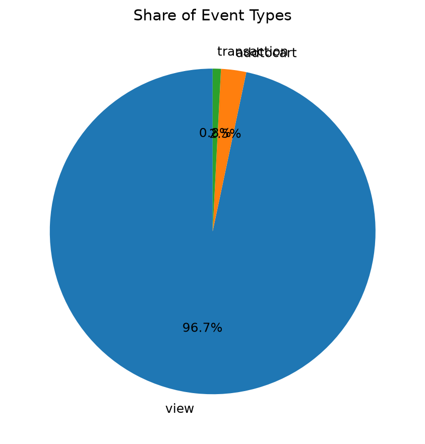
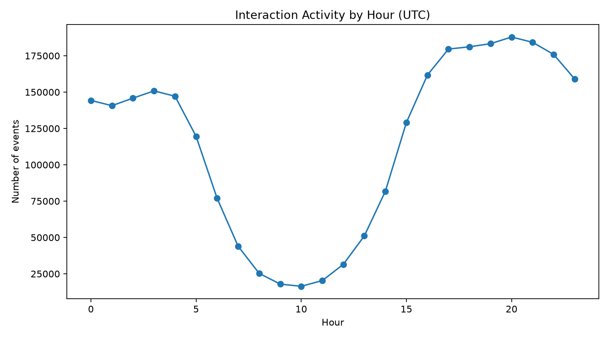
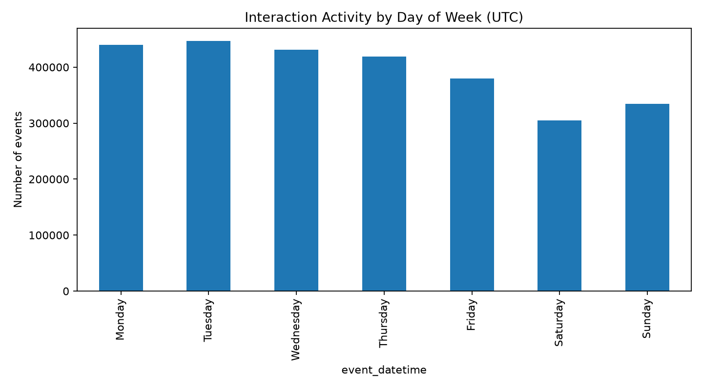
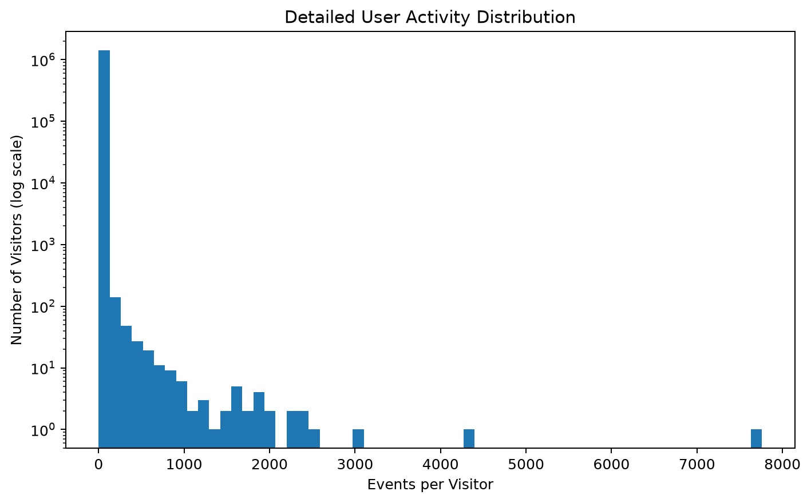
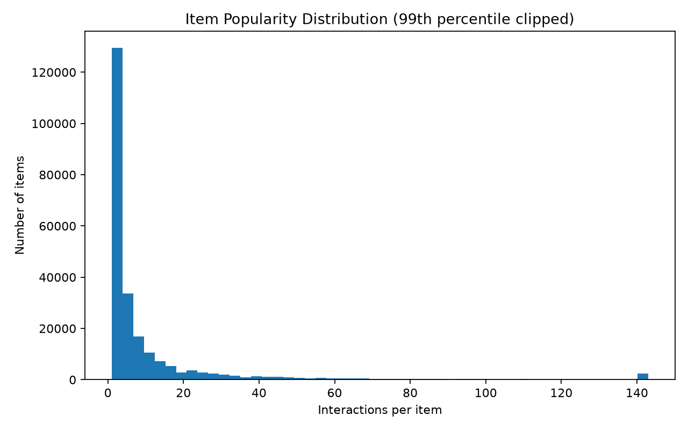

# Retailrocket Exploratory Data Analysis

## 1. Dataset overview

The prepared dataset contains **2,755,651 events**, **1,407,580 visitors** and **235,061 items**.

## 2. Event type distribution

**What was applied:** Frequency counts and percentage calculation by event type.

**Why:** To understand the balance between browsing, cart activity and purchases. Different events represent different levels of user intent.

| Event | Count | Percentage |
|---|---:|---:|
| view | 2,664,219 | 96.68% |
| addtocart | 68,975 | 2.50% |
| transaction | 22,457 | 0.81% |

**Interpretation:** Views, add-to-cart events and transactions have different frequencies. This supports treating the data as implicit feedback rather than explicit star ratings. The configured weights (view=1, addtocart=3, transaction=5) are modelling assumptions.

## 3. Temporal analysis

**What was applied:** Events were grouped by UTC hour and weekday.

**Why:** To identify time-based activity patterns that may inform future time-aware recommendations.

**Interpretation:** Use the charts to identify peak periods. These timestamps are UTC; they have not been converted to local time.

## 4. User activity distribution

**What was applied:** Counted events per visitor and plotted a histogram, clipping the displayed distribution at the 99th percentile.

**Why:** To inspect whether interactions are evenly distributed or concentrated among a small group of visitors.

**Interpretation:** A skewed distribution indicates that users have different levels of activity. This is relevant to cold-start and popularity-bias considerations.

## 5. Item popularity distribution

**What was applied:** Counted interactions per item and plotted a histogram, clipping the display at the 99th percentile.

**Why:** To investigate whether a small number of products account for a large share of interactions.

**Interpretation:** A long-tailed distribution would indicate that many items receive relatively few interactions. This affects recommendation coverage.

## 6. User-item matrix sparsity

The initial profiling measured matrix sparsity at **99.99935%**.

**Why:** Sparsity measures how few possible visitor-item combinations have observed interactions.

**Interpretation:** The interaction matrix is extremely sparse. Collaborative filtering therefore has limited evidence for many user-item combinations. This is a key modelling challenge.

## 7. Data-quality findings

The raw event file contained 2,756,101 rows. Validation found 460 duplicate rows, no missing visitor IDs, no missing item IDs, no invalid timestamps and no unknown event types. The validation status was PASS.

## 8. EDA decisions

1. Retain the three event types as implicit feedback.
2. Use documented event weights as modelling assumptions, not ratings.
3. Preserve timestamps for temporal feature engineering.
4. Consider cold-start and long-tail effects when interpreting recommendation performance.
5. Report the high matrix sparsity as a limitation of collaborative filtering.

## 9. Limitations

This analysis describes the available historical Retailrocket snapshot. It does not establish live customer behaviour or causal effects. UTC is used for temporal grouping. The event-weight values are assumptions and should be tested in future experiments.

## 10. Methodology and rationale

The detailed analysis procedures, reasons for applying each technique, findings and resulting decisions are documented in `docs/EDA_METHODOLOGY.md`.

All percentages and activity statistics in this report were calculated from the prepared Retailrocket dataset. The plots are saved in `reports/figures/`.
